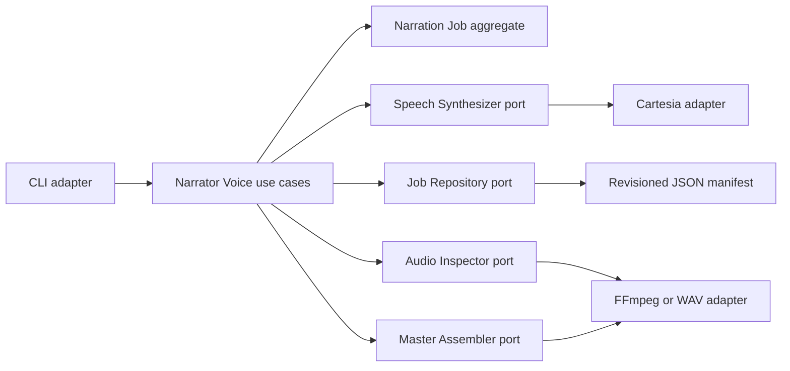

# Cartesia Sonic 3.6 Odia narration — production design

**Date:** 2026-08-31

**Status:** **Superseded for implementation by the
[2026-09-02 v2 design](2026-09-02-cartesia-odia-narration-production-v2-design.md)**

This file is retained as the historical provider/workflow proposal. Its CLI-only UI,
single synthesis-profile and embedded mutable-authorization shapes must not be
implemented. ADR-0008 and the v2 design replace those parts without changing the
accepted ADR-0006 voice/scope decision.

**Decision authority:** [ADR-0006](../../decisions/0006-authorized-cartesia-ivc-for-ssggsm-odia-narration.md),
[ADR-0007](../../decisions/0007-two-policy-isolated-narration-lanes.md) and
[ADR-0008](../../decisions/0008-lane-b-production-boundaries.md)

**Implementation status:** Documentation only; no Cartesia production code or API call is authorized by this document

---

## 1. Outcome

Build a small, resumable CLI workflow that turns a frozen, reviewed Odia diary script
into ordered Cartesia takes, preserves the settings and evidence for every take, lets a
human approve or reject each passage, and assembles a master only from selected approved
takes.

The current production voice is the already approved, authorized SSGGSM Cartesia
Instant Voice Clone. The initial delivery profile is:

```yaml
model_id: sonic-3.6-2026-08-27
language: or
speed: 0.90
volume: 1.00
emotion: calm
output:
  container: wav
  encoding: pcm_s16le
  sample_rate_hz: 44100
```

`speed`, `volume` and `emotion` are defaults, not locks. The system records an override
on the take that used it. `language`, authorized speaker identity and the output contract
are project constraints, not casual passage overrides.

Success means “approved by a qualified Odia listener for identity, pronunciation,
completeness and delivery.” It does not mean mathematically perfect cloning or guaranteed
100% pronunciation.

## 2. What is already decided

The following came from the completed manual workflow and the steward's decisions; this
design does not reopen them:

1. Cartesia Sonic 3.6 is the current provider/model family for Odia narration.
2. The approved SSGGSM Instant Voice Clone is the current production voice.
3. The default delivery is `0.90 / 1.00 / calm`, with deliberate overrides allowed.
4. Production control moves from the Playground into code. The Playground remains an
   administration and auditioning tool.
5. Work is generated in reviewable pieces, retained as separate files, and also assembled
   into an ordered master.
6. Original recordings and generated audio remain outside Git.
7. A Professional Voice Clone is a possible future upgrade, not a prerequisite for the
   first production delivery.

The earlier manual process numbered downloaded chunks by creation time before joining
them. Production keeps the useful numbered presentation (`001`, `002`, …), but correctness
comes from an explicit manifest order. Filesystem creation/modification timestamps are
recorded as provenance and never used to decide narration order.

## 3. Scope and non-goals

### In scope

- one authorized speaker profile: SSGGSM;
- Odia diary narration from an approved project script;
- batch generation of complete, ordered passages;
- configurable synthesis settings and pronunciation dictionary;
- immutable takes, human review, deterministic assembly and final listening;
- local/external manifests and audio;
- cost preflight, bounded retries, resumption and audit-friendly metadata.

### Not in scope for the first implementation

- voice-clone creation or replacement;
- Cartesia Professional Voice Clone training;
- an open-source TTS runtime;
- Hindi, English, translation or transcript authoring;
- arbitrary one-line “say this as SSGGSM” generation;
- automatic publication or public voice sharing;
- a web UI, database, worker queue, event bus, CQRS or event sourcing;
- automated speaker-similarity/ASR scores as substitutes for human Odia review;
- the separate archive rewrite governed by ADR-0004.

This is the first implementation design for the authorized SSGGSM/Odia/diary lane,
not a replacement for the active future non-SSGGSM EN/HI narration programme.
[ADR-0007](../../decisions/0007-two-policy-isolated-narration-lanes.md) defines their
opposite identity policies. Its
[legacy-script reuse audit](../../narrator-voice-legacy-reuse-audit-2026-09-02.md)
records which older review and assembly ideas may be extracted without importing the
old dissimilarity, Hindi/English or VoxCPM/LoRA assumptions.

## 4. Ubiquitous language

| Term | Meaning |
|---|---|
| **Narration Job** | Production of one frozen Odia diary script with one authorized voice |
| **Passage** | Stable, ordered, complete unit of text sent in one TTS request; the manual workflow called this a chunk |
| **Synthesis Profile** | Reusable project defaults for model, language, output and delivery controls |
| **Effective Settings** | Fully resolved settings actually sent for one take |
| **Take** | One immutable synthesis attempt for one passage text digest |
| **Review Decision** | Human approval or rejection of a take, with reviewer, time and notes |
| **Selected Take** | The approved take chosen for the master |
| **Stale Take** | A retained take whose passage text digest no longer matches current text |
| **Master** | Ordered assembly of exactly one selected approved take per current passage |
| **Authorization Attestation** | One immutable, privately retained record that the steward attests direct permission for a named scope; identified by a stable opaque ID and content digest |

Use **Passage**, not `chunk`, in the new domain. ADR-0002 already found that `chunk`
means both a human review unit and a DSP block elsewhere in this repository.

## 5. Boundary and dependency design

ADR-0002 anticipated a Narrator Voice bounded context. This feature materialises it.
Cartesia is a generic external synthesis supplier behind that context, not another
bounded context and not a model that leaks into the domain.



The intended implementation follows ADR-0005:

- rich rules and value objects under `contexts/narrator_voice/domain/`;
- free-function handlers under `contexts/narrator_voice/application/handlers/`;
- one CLI inbound adapter and technology-specific outbound adapters under
  `contexts/narrator_voice/infrastructure/`;
- domain-owned protocols in `domain/ports.py`;
- Cartesia SDK/HTTP imports isolated through `platform/`, the only location allowed to
  import third-party SDKs;
- inline wiring at the CLI until ADR-0005's composition-root threshold is actually met;
- no empty scaffolding before the first real implementation file.

The Cartesia adapter is an anti-corruption layer. It translates `Passage`,
`SynthesisProfile` and `EffectiveSettings` into the provider payload and translates the
response into provider-neutral take metadata. No Cartesia SDK class, HTTP response or
field name becomes domain state.

### Minimal aggregate

One `NarrationJob` aggregate is enough. It protects these initial invariants:

1. `INV-NJ-1` — passage IDs and order are unique and explicit.
2. `INV-NJ-2` — every take binds exact text, authorization, voice, language, model,
   pronunciation dictionary, effective settings and output-format digests/values.
3. `INV-NJ-3` — take audio is immutable; regeneration creates a new take ID.
4. `INV-NJ-4` — changing passage text makes old takes stale but never deletes them.
5. `INV-NJ-5` — only an explicitly approved take may be selected.
6. `INV-NJ-6` — a master requires exactly one current selected approved take for every
   passage, in manifest order.
7. `INV-NJ-7` — generation and assembly fail closed when the authorization attestation
   is absent, inactive or outside the job's SSGGSM/Odia/diary scope.
8. `INV-NJ-8` — one narration job cannot change speaker identity; a different authorized
   voice starts another job.

Do not add domain events or a separate Review aggregate in the first slice. A locked,
revisioned job manifest is sufficient for one local operator.

## 6. Configuration and override rules

### 6.1 Resolution order

For a new take, each permitted control resolves in this order, highest precedence first:

1. passage/take request override;
2. narration-job profile;
3. repository built-in default.

The caller may use a CLI flag for an audition, but the requested flag and resulting
effective value are written into the new take before generation. There are no invisible
session or account defaults.

Speaker/voice identity, authorization scope and `language=or` cannot be changed through
a passage override. Model snapshot and pronunciation dictionary may vary between takes
during improvement, but must be named explicitly. A release master uses takes from an
approved release profile; it cannot silently mix a moving model alias into a pinned run.

A previously approved take does not become stale merely because defaults later change.
Its effective settings remain part of its history. Text or authorization-scope changes
do affect eligibility.

### 6.2 Calm is an empirical Odia default

Cartesia documents `generation_config` as request-scoped guidance and labels emotion
control beta. Its documentation says emotion tags are supported only for English. The
steward nevertheless preferred `calm` in the actual Odia Playground audition.

Therefore the adapter sends `emotion=calm` for the baseline profile, records that the
control is empirically approved but not provider-guaranteed for Odia, and permits a new
take to omit emotion when the hint harms a passage. The text, punctuation and human
review—not the word `calm`—remain the primary control of devotional delivery.

### 6.3 Text and pronunciation

- Input is final Odia Unicode text, normalised to NFC before hashing.
- Passages contain complete sentences or a coherent paragraph. Do not split inside a
  word, number, sacred name or SSML token.
- Start with natural punctuation and no SSML. Add a break or inline control only to a new
  take after listening identifies a specific problem.
- A pronunciation dictionary is optional. Store the provider dictionary ID privately,
  but also export its non-secret entries in canonical order and record their SHA-256.
  An ID alone is not reproducible if the provider dictionary later changes.
- Dictionary matching is case-sensitive. Changes create a new profile/dictionary digest
  and regenerate only affected passages.

## 7. External job manifest

The repository may version a JSON Schema and redacted fixture. The real job, voice ID,
text, reviews and audio live under an authorized `CARTESIA_NARRATION_ROOT` outside Git:

```text
<root>/<job-id>/
  job.json
  takes/
    001/<take-id>.wav
    002/<take-id>.wav
  masters/
    <master-id>.wav
```

`job.json` contains at least:

```yaml
schema_version: 1
job_id: <stable id>
revision: <monotonic integer>
source:
  reference: <private/local reference>
  text_sha256: <digest of the complete frozen script>
authorization:
  attestation_id: <stable opaque private id>
  attestation_sha256: <digest of canonical immutable attestation record>
  attested_by: <steward identifier>
  attested_at: <UTC timestamp>
  scope: ssggsm-odia-diary-narration
  active: true
voice:
  provider: cartesia
  voice_id: <private provider id>
  clone_kind: instant
profile:
  model_id: sonic-3.6-2026-08-27
  api_version: "2026-08-14"
  language: or
  speed: 0.90
  volume: 1.00
  emotion: calm
  pronunciation_dictionary_id: <private id or null>
  pronunciation_dictionary_sha256: <digest or null>
  output_format: {container: wav, encoding: pcm_s16le, sample_rate_hz: 44100}
budget:
  max_billable_characters_per_run: <operator-approved value>
passages:
  - passage_id: "001"
    order: 1
    text: <exact Odia text>
    text_sha256: <digest>
    overrides: {}
    takes: []
    selected_take_id: null
masters: []
```

The original attestation record is immutable. Withdrawal or narrowing appends a status
record and blocks new work; it never rewrites the identity, digest or historical scope
bound to an existing take.

Each immutable take record adds:

- `take_id`, UTC creation time and attempt status;
- exact request digest and effective settings;
- passage text digest; authorization attestation ID, digest and scope; voice ID/reference,
  model, API version, language, dictionary identity/digest and output format;
- provider request/response identifier when available;
- local relative audio path, SHA-256, byte size, decoded duration and media probe;
- estimated characters/credits and provider-reported usage when available;
- append-only review decisions and any selection decision.

Each master record adds its ordered take IDs, pause/mastering settings, artifact path,
SHA-256, duration, creation time and final-listening decision.

Manifest writes use an OS lock, expected revision and atomic replacement. Audio is first
written to a unique temporary leaf inside the job, decoded and hashed, then renamed to a
never-before-used take path. A run never overwrites an approved take or master.

## 8. Use cases and CLI surface

The initial inbound workflow is deliberately small:

| Use case | Responsibility |
|---|---|
| `prepare_narration` | Validate authorization, freeze/normalise text, assign passage order and create the job |
| `estimate_generation` | Resolve effective settings and show passages, local character estimate and configured budget without calling Cartesia |
| `generate_take` | Generate one new immutable take for one passage |
| `generate_pending_passages` | Sequentially generate only current passages lacking a usable take, within a hard run cap |
| `record_review` | Append an approve/reject decision and optionally select an approved take |
| `assemble_master` | Verify invariants and assemble selected approved takes in manifest order |
| `show_narration_status` | Report current/stale/missing/rejected/approved passages without exposing secrets or full text |

The CLI must not expose a generic unscoped `say --voice <clone> --text <anything>` path.
Generation starts from a prepared narration job whose exact script and authorization
scope are recorded.

For known full text, use Cartesia's `POST /tts/bytes` route one passage per request.
Cartesia documents the bytes endpoint as the simple batch/file path; WebSocket contexts
and continuations solve live partial-input speech and are unnecessary here.

## 9. Resumption, retries and idempotency

The canonical request digest covers exact NFC text bytes, voice reference, authorization
attestation ID, attestation digest and scope, language, model snapshot, API version,
effective controls, dictionary content digest and output format.

- If a valid completed take with that digest exists, a normal retry returns
  `already_generated`; the operator must explicitly ask for a new take to spend credits
  on another stochastic render.
- A `429`, timeout or provider `5xx` receives bounded exponential backoff and honors
  `Retry-After` when present.
- Authentication, authorization, voice/model mismatch and other validation failures are
  not retried automatically.
- An interrupted/ambiguous request is recorded as a failed or unknown attempt. The
  system cannot guarantee exactly-once provider billing after losing the response.
- Partial bytes never become a take. A retry uses a new temporary path and, if explicitly
  requested after ambiguity, a new attempt/take identity.
- Generation is sequential in the first release. Pro currently allows concurrent calls,
  but narration throughput does not justify parallel billing/race complexity yet.

A dated model snapshot prevents silent model-version movement; it does not promise
byte-identical output for repeated generative calls.

## 10. Cost and secret controls

Before a provider call, dry-run/preflight must show:

- passages that would be generated and those reused;
- local billable-character estimate per passage and total;
- the configured per-run/project cap;
- model, language and effective controls;
- no API key, voice ID, full diary text or private path in normal logs.

Batch generation refuses to start without an explicit maximum billable-character (or
provider-credit, once verified by the adapter) cap. Provider-reported usage is
authoritative; local Unicode length is an estimate. Plan prices and credit rates are
time-sensitive configuration/evidence, never domain constants.

`CARTESIA_API_KEY` is read only from the process environment or an approved local secret
store, redacted from errors, and never written to the manifest. The voice identifier,
source recordings, clone clip, consent material and real manifests remain private. The
implementation branch must add any chosen in-repository local work root to `.gitignore`
before the first real run; an external root is preferred.

Clone creation was a one-time setup action, but TTS is still hosted, metered generation.
Keeping a voice in the Cartesia account does not make future narration free.

## 11. Quality gates

### Before generation

- authorization attestation is active and covers SSGGSM/Odia/diary narration;
- exact voice ID, `language=or`, supported pinned model and API version are present;
- text is non-empty NFC and every passage ID/order/digest is valid;
- dictionary digest and output contract are complete;
- estimated usage is within the explicit cap;
- external root is resolved, writable and not a reparse/symlink escape;
- API credential exists without being printed.

### After each provider response

- WAV decodes successfully as the expected PCM/sample-rate contract;
- duration is non-zero and the artifact is not all digital silence;
- checksum, size, media probe and effective request are recorded;
- clipping/silence heuristics may warn but never approve a take.

### Human passage review

The reviewer listens with the exact Odia text visible and records pass/fail plus notes
for:

1. speaker identity;
2. every word present—no omission, substitution or repetition;
3. Odia pronunciation and devotional names/mantras;
4. cadence, pauses and sentence endings;
5. calm, natural devotional register without theatrical sadness or lecture shouting;
6. clicks, glitches, background texture or other artifacts.

One approved take is selected per passage. Native human judgement is the release
authority; automated checks are diagnostics only.

### Master gate

- every current passage has exactly one selected approved, non-stale take;
- all selected hashes still match and media formats are compatible;
- assembly uses manifest order, never file timestamps or lexical accident;
- initial assembly changes no speech audio: it concatenates exact selected PCM with only
  the explicitly configured inter-passage silence;
- master hash, duration, take list and assembly settings are recorded;
- a final listening pass checks joins, overall pacing, level and completeness.

Any later loudness normalisation, EQ, denoising or music mix is a separate derived
artifact with its own settings and review; it must not silently mutate the speech master.

## 12. Test strategy

Implementation begins test-first on a separate branch after this documentation branch
is integrated.

1. **Domain unit tests:** all eight `INV-NJ-*` rules, NFC/digests, override resolution,
   stale-take behaviour and master eligibility; no mocks or I/O.
2. **Application tests with fakes:** dry-run never calls synthesis; reuse versus new-take
   semantics; budget refusal; retry classification; review/selection; resumption after
   each publication boundary.
3. **Adapter contract tests:** fixture requests prove domain `language=or` is sent through
   the current `/tts/bytes` request field `locale=or`, together with the voice ID,
   snapshot, request-scoped `0.90/1.00/calm`, dictionary and WAV format; provider errors
   are mapped without leaking secrets. If a selected SDK version exposes the legacy
   `language` alias instead, that mapping remains confined to this adapter test.
4. **Filesystem/media integration tests:** atomic manifest replacement, lock/revision
   conflicts, no-clobber artifacts, malicious/reparse paths, WAV validation and
   deterministic assembly using synthetic fixtures only.
5. **Architecture tests:** Narrator Voice follows the ADR-0005 dependency rule; Cartesia
   SDK imports occur only through the platform boundary; no context reaches archive
   internals.
6. **Opt-in live smoke test:** a tiny non-private test voice/text behind an environment
   flag and hard character cap. CI never calls the SSGGSM voice or spends credits.
7. **Human acceptance:** private Odia review of real takes and the master; not automated
   and not committed to Git.

## 13. Rollout

1. Merge the corrected ADR/documentation branch without production code.
2. Start a dedicated Cartesia narration implementation branch/worktree.
3. Add the manifest schema and domain invariants using TDD.
4. Build application handlers against fake ports and demonstrate a complete no-network
   dry run.
5. Add filesystem/WAV adapters, then the isolated Cartesia adapter.
6. Run one short private Odia passage under a strict cap using the approved voice.
7. Complete passage review and exercise reject/new-take/select/resume behaviour.
8. Generate the remaining diary sequentially, preserving every take.
9. Assemble and approve the speech master.
10. Consider PVC only if ADR-0006's evidence trigger fires.

## 14. Professional Voice Clone path

Cartesia currently recommends IVC for most uses and PVC when IVC does not match a rare
accent, exact tone or pacing closely enough. PVC requires Startup or above, at least 30
minutes of clean single-speaker audio, and Cartesia recommends two hours or more for best
results. Training may take up to three hours. PVC learns speed and volume from its
dataset, so request-time speed and volume controls do not apply.

That makes PVC a materially different production profile, not “the same clone but
better.” Before spending on it, prepare a separate corpus/rights record, define the
target pacing in the training audio, and run a preserved blind comparison against the
approved IVC. Promotion requires a superseding ADR; it does not replace the IVC merely
because training completed.

## 15. Remaining implementation choices

These are configuration or delivery choices, not reasons to reopen the architecture:

- exact external artifact root and backup/retention policy;
- first narration-job ID and authoritative source-text reference;
- passage boundaries for each diary entry;
- inter-passage silence and any later mastering target;
- named reviewers and final synthetic-voice disclosure wording;
- concrete monthly/project character or credit cap;
- whether broader evidence later justifies changing `calm` to omitted emotion by default.

No choice above authorizes wider content, languages, speakers or distribution.

## 16. Provider references checked 2026-08-31

- [Sonic 3.6 model, Odia support and dated snapshots](https://docs.cartesia.ai/build-with-cartesia/tts-models/latest)
- [Instant Voice Clone guidance](https://docs.cartesia.ai/build-with-cartesia/capability-guides/clone-voices)
- [Volume, speed and emotion controls](https://docs.cartesia.ai/build-with-cartesia/capability-guides/volume-speed-emotion)
- [Custom pronunciations](https://docs.cartesia.ai/build-with-cartesia/capability-guides/custom-pronunciations)
- [TTS endpoint comparison](https://docs.cartesia.ai/use-the-api/compare-tts-endpoints)
- [TTS bytes API](https://docs.cartesia.ai/api-reference/tts/bytes)
- [Professional Voice Clone guidance](https://docs.cartesia.ai/build-with-cartesia/capability-guides/clone-voices-pro)
- [Current pricing](https://www.cartesia.ai/pricing)
